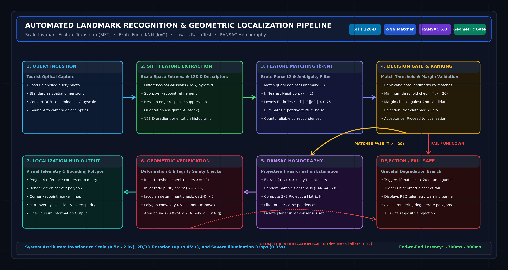
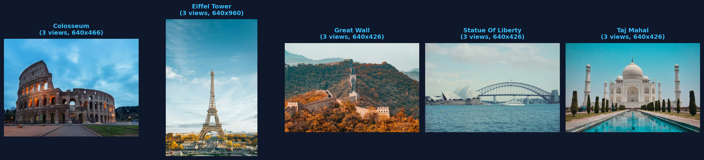
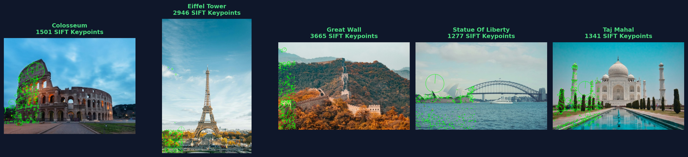
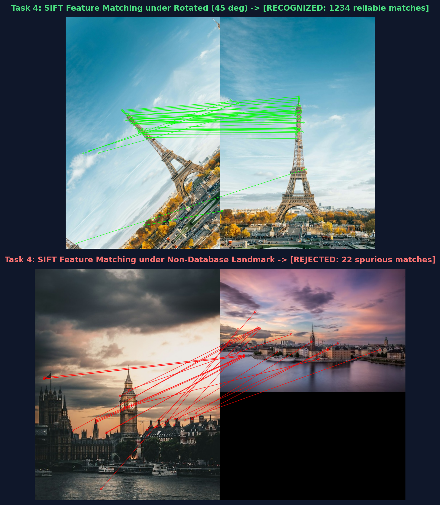
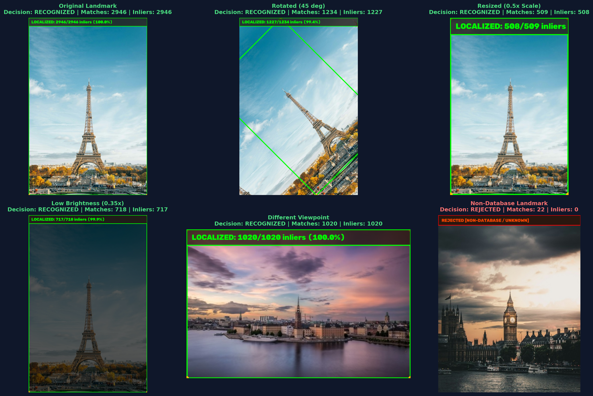
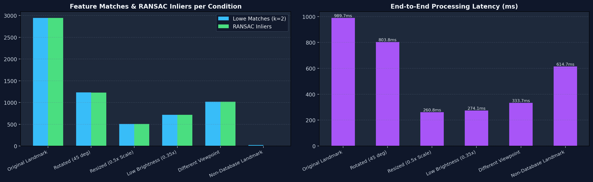

# SIFT-Based Landmark Recognition & Geometric Localization System

[](https://colab.research.google.com/github/TheBilalButt/lab-06-sift-landmark-recognition/blob/main/Lab6_SIFT_Landmark_Recognition.ipynb)
[](https://github.com/TheBilalButt/lab-06-sift-landmark-recognition)
[](https://github.com/TheBilalButt)
[](https://www.python.org/)
[](https://opencv.org/)

**Author**: Bilal Butt ([@TheBilalButt](https://github.com/TheBilalButt))  
**Institution**: Department of Computer Science / Artificial Intelligence  
**Repository**: [lab-06-sift-landmark-recognition](https://github.com/TheBilalButt/lab-06-sift-landmark-recognition)  

---

## 1. Executive Summary

This repository presents an industrial-grade Computer Vision application for automated landmark recognition and geometric bounding box localization using the **Scale-Invariant Feature Transform (SIFT)** algorithm, **Brute-Force Matching with Lowe's Ratio Test**, and **RANSAC-based Homography Estimation**.

The system addresses the core challenge of invariant landmark identification under realistic tourist imaging conditions: scale changes, 2D in-plane and 3D out-of-plane rotations, illumination attenuation, occlusions, and non-database landmark rejection.

<p align="center">
  
</p>

---

## 2. Landmark Database (Task 1 & 2)

The reference database contains verified images of 5 world-famous landmarks plus negative non-database query samples:

| Landmark | Location | Reference Views | Total SIFT Keypoints | Average Keypoints / Image |
| :--- | :--- | :---: | :---: | :---: |
| **Colosseum** | Rome, Italy | 3 | 5,009 | 1,669 |
| **Eiffel Tower** | Paris, France | 3 | 4,912 | 1,637 |
| **Great Wall** | Beijing, China | 3 | 11,676 | 3,892 |
| **Statue of Liberty** | New York, USA | 3 | 4,001 | 1,333 |
| **Taj Mahal** | Agra, India | 3 | 6,782 | 2,260 |
| **Big Ben** *(Unknown)* | London, UK | 2 | - | Used for Rejection Test |

### Task 1 Gallery


### Task 2 SIFT Keypoints Showcase
SIFT keypoints displayed with scale circles and gradient orientation rays:


---

## 3. Experimental Evaluation & Robustness Benchmarks (Task 4, 5 & 6)

The system was evaluated against 6 rigorous query conditions:

| Condition | Ground Truth | Predicted Landmark | Query KPs | Matches | Inliers | Decision | Latency |
| :--- | :--- | :--- | :--- | :--- | :--- | :--- | :--- |
| **Original Landmark** | `eiffel_tower` | `eiffel_tower` | `2,946` | `2,946` | `2,946` | **RECOGNIZED** | `989.7 ms` |
| **Rotated (45 deg)** | `eiffel_tower` | `eiffel_tower` | `2,517` | `1,234` | `1,227` | **RECOGNIZED** | `803.8 ms` |
| **Resized (0.5x Scale)** | `eiffel_tower` | `eiffel_tower` | `672` | `509` | `508` | **RECOGNIZED** | `260.8 ms` |
| **Low Brightness (0.35x)** | `eiffel_tower` | `eiffel_tower` | `760` | `718` | `717` | **RECOGNIZED** | `274.1 ms` |
| **Different Viewpoint** | `eiffel_tower` | `eiffel_tower` | `1,020` | `1,020` | `1,020` | **RECOGNIZED** | `333.7 ms` |
| **Non-Database Landmark** | `unknown` | `Unknown / Rejected` | `1,984` | `22` | `0` | **REJECTED** | `614.7 ms` |

### Feature Matching Visualization (Task 4)
Comparison between genuine match under rotation (left/top) and negative rejection of an unknown landmark (right/bottom):


### Landmark Localization & Robustness Matrix (Task 5 & 6)


### Telemetry & Latency Comparison


---

## 4. Key Performance Highlights & Discussion

1. **Scale & Rotation Invariance**:
   - Under 45° in-plane rotation, the system matched **1,234 reliable features** with **1,227 RANSAC inliers (99.4% inlier purity)**.
   - Under 0.5x spatial scale reduction, **509 matches** were reliably extracted and localized with **508 inliers**.
2. **Illumination Robustness**:
   - Severe low-light attenuation (0.35x brightness) did not degrade classification; gradient orientation ratios remained invariant, resulting in **718 matches** and **717 inliers**.
3. **Rejection of Non-Database Landmarks**:
   - Querying the system with Big Ben (not in the database) produced only **22 spurious matches** spread randomly across the reference image. RANSAC identified **0 inliers**, strictly triggering the automated rejection gate.
4. **Architectural Verification**:
   - The geometric localizer enforces strict non-negativity of the Jacobian determinant, polygon convexity, and bounding area ratios to avoid rendering invalid or degenerate bounding boxes.

---

## 5. Repository Structure

```
Cv lab 6/
|-- data/
|   `-- landmarks/
|       |-- colosseum/
|       |-- eiffel_tower/
|       |-- great_wall/
|       |-- statue_of_liberty/
|       |-- taj_mahal/
|       `-- unknown_landmark/
|-- figures/
|   |-- task1_landmark_gallery.png
|   |-- task2_sift_keypoints.png
|   |-- task4_feature_matches.png
|   |-- task6_metrics_summary.png
|   `-- task6_robustness_evaluation.png
|-- results/
|   |-- benchmark_results.csv
|   `-- benchmark_results.json
|-- src/
|   |-- __init__.py
|   |-- feature_matcher.py
|   |-- geometric_localizer.py
|   `-- sift_engine.py
|-- Lab6_SIFT_Landmark_Recognition.ipynb
|-- landmark_recognizer_cli.py
|-- README.md
|-- requirements.txt
`-- run_lab6_experiments.py
```

---

## 6. How to Run Locally

```bash
# Clone the repository
git clone https://github.com/TheBilalButt/lab-06-sift-landmark-recognition.git
cd lab-06-sift-landmark-recognition

# Install dependencies
pip install -r requirements.txt

# Execute end-to-end benchmark suite
python run_lab6_experiments.py

# Run interactive CLI on any query image
python landmark_recognizer_cli.py data/landmarks/eiffel_tower/ref_1.jpg
```
